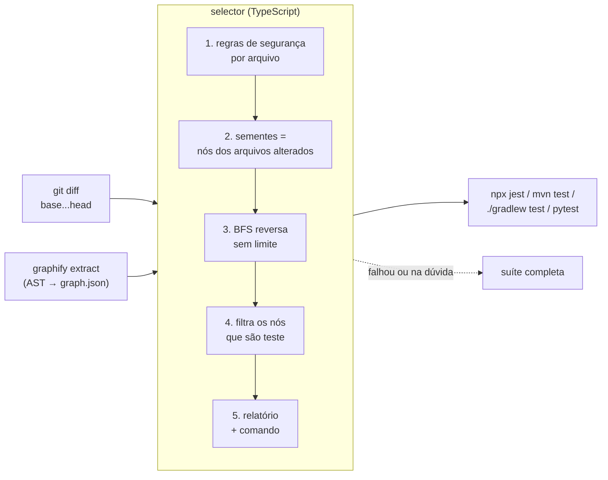
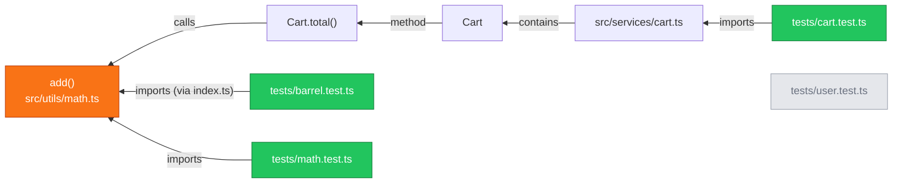

<div align="center">


# test-graph-selector

**Rode só os testes que o seu diff pode ter quebrado, e saiba exatamente por quê.**

Seleção de testes determinística por grafo de dependências (AST). Sem IA no núcleo:
mesma entrada, mesma saída, byte a byte.

[](https://github.com/Pedronovaesdev/test-graph/actions/workflows/selective-tests.yml)
[](https://github.com/Pedronovaesdev/test-graph/actions/workflows/action-selftest.yml)
[](selector/package.json)
[](selector/package.json)
[](https://github.com/Graphify-Labs/graphify)

[](selector/languages/typescript.yml)
[](selector/languages/angular.yml)
[](selector/languages/java.yml)
[](demo/spring-project)
[](selector/languages/python.yml)

[Como funciona](#-como-funciona) ·
[No CI](#-no-ci-github-action) ·
[No seu PC](#-no-seu-pc) ·
[Resultados](#-resultados-em-projetos-reais) ·
[Arquitetura](docs/ARQUITETURA.md)

</div>

---

```text
$ ./select-tests.sh --project demo/ts-project --base HEAD~1 --head HEAD
SELETIVO: 3 de 6 testes (50% economizado)

Testes selecionados e por que:
  * tests/barrel.test.ts
      tests/barrel.test.ts --importa--> add() [alterado em src/utils/math.ts]
  * tests/cart.test.ts
      tests/cart.test.ts --importa--> src/services/cart.ts --importa--> src/utils/math.ts [alterado em src/utils/math.ts]
  * tests/math.test.ts
      tests/math.test.ts --importa--> src/utils/math.ts [alterado em src/utils/math.ts]

Comando: npx jest --ci --passWithNoTests --runTestsByPath tests/barrel.test.ts tests/cart.test.ts tests/math.test.ts
```

## ✨ Destaques

- 🎯 **Seleção por dependência real.** Lê o código (AST), monta o grafo de quem importa, chama, herda ou implementa quem e anda nele ao contrário a partir do que mudou, sem limite de profundidade.
- 🔍 **Explicável.** Cada teste vem com a cadeia completa até o arquivo alterado, em texto (log), JSON (máquina) e Markdown (Job Summary do GitHub).
- 🛡️ **Seguro por padrão.** Na dúvida, roda mais. Config, lockfile, código que o grafo não explica ou qualquer erro da ferramenta levam à **suíte completa**. Um erro nunca significa teste pulado.
- ♻️ **Determinístico.** Sem IA, sem heurística aleatória. O mesmo commit gera o mesmo relatório.
- 🧩 **Multilinguagem por configuração.** Uma linguagem nova é um arquivo YAML, sem mudar código.
- ⚙️ **Pronto para CI.** GitHub Action de um passo, com cache do indexador e o relatório no Job Summary.

## 🧭 Como funciona



Uma aresta `A → B` no grafo significa **"A depende de B"**. Partindo dos símbolos do
arquivo alterado e seguindo as setas ao contrário, a busca chega em todo teste que
depende dele, direta ou indiretamente:



<sub>🟧 alterado · 🟩 selecionado · ⬜ não afetado (fica de fora)</sub>

1. **Diff** ([`diff.ts`](selector/src/diff.ts)): `git diff --name-status -z -M base...head`. Renomeação traz os dois caminhos.
2. **Grafo** (indexador externo): `graphify extract --no-cluster` gera nós (arquivos, classes, funções, métodos) e arestas (`imports`, `calls`, `inherits`, `implements`, `contains`, `method`…). Com remoção ou renomeação, o merge-base também é indexado (via `git worktree`) e as duas buscas são unidas.
3. **Regras** ([`rules.ts`](selector/src/rules.ts)): decidem, arquivo a arquivo, se a mudança vira semente, seleção direta, suíte completa ou nada.
4. **Busca reversa** ([`graph.ts`](selector/src/graph.ts)): BFS a partir de várias sementes, guardando o pai de cada nó para reconstruir a cadeia. Interfaces e herança são seguidas também no sentido direto (polimorfismo / injeção de dependência).
5. **Seleção e relatório** ([`engine.ts`](selector/src/engine.ts), [`report.ts`](selector/src/report.ts)): os nós de teste viram o comando do runner da linguagem.

<details>
<summary><b>Por que não usar o <code>graphify affected</code>? Por que <code>--no-cluster</code>?</b></summary>

<br/>

O graphify tem um comando de impacto, mas ele aceita uma semente só, para na
profundidade 2 por padrão (corta cadeias como `add() → Cart.total() → cart.ts →
cart.test.ts`) e não devolve o caminho. Por isso o graphify é usado **apenas como
indexador AST**; diff, busca, regras, seleção, relatório, shell e CI são código
deste repositório.

No modo padrão, o graphify guarda o grafo como não-direcionado e colapsa arestas
opostas entre o mesmo par de nós: num ciclo de import `a.ts ↔ b.ts`, uma das
direções some. Com `--no-cluster` ele grava a extração crua (chave `edges`),
direcionada e sem esse colapso. Verificado na v0.9.90: é um superconjunto das
arestas do modo padrão e é determinístico byte a byte.

</details>

## 🚀 No CI (GitHub Action)

Este repositório é também uma GitHub Action. Em qualquer outro repositório:

```yaml
name: Testes

on: [pull_request]

jobs:
  testes:
    runs-on: ubuntu-latest
    steps:
      - uses: actions/checkout@v4
        with:
          fetch-depth: 0              # obrigatório: o diff precisa do histórico

      - uses: actions/setup-node@v4   # a Action usa o Node do runner
        with:
          node-version: "20"

      - run: npm ci                   # dependências do SEU projeto

      - uses: Pedronovaesdev/test-graph@v1
        with:
          dry-run: true               # comece só observando o que seria escolhido
```

A Action instala o graphify num venv próprio, usa o seletor já empacotado
(`selector/dist/cli.js`, sem `npm ci` nem build), restaura o cache
do indexador, calcula a base (base do PR, ou o commit anterior ao push), roda a
seleção e executa os testes. O relatório aparece no **Job Summary** do run.

> [!TIP]
> Para Java use `actions/setup-java`; para Python, `actions/setup-python` + `pip install`.
> A Action não troca a versão da linguagem do seu projeto.

<details>
<summary><b>Entradas e saídas da Action</b></summary>

<br/>

| Entrada | Padrão | Descrição |
|---|---|---|
| `base` | automático | Commit de comparação. Vazio = base do PR (`pull_request`) ou commit anterior ao push |
| `head` | `HEAD` | Commit analisado |
| `project` | `.` | Pasta do projeto dentro do repositório (monorepo) |
| `lang` | detecta | `typescript`, `angular`, `vitest`, `java`, `java-gradle`, `python`, ou o caminho de um `.yml` do projeto |
| `dry-run` | `false` | `true` = só seleciona e explica, sem rodar os testes |
| `graphify-version` | `0.9.90` | Versão do indexador AST |
| `cache` | `true` | Guarda o cache do graphify entre execuções (só os arquivos alterados são relidos) |

| Saída | Descrição |
|---|---|
| `mode` | `selective`, `full`, `none` ou `fail-safe` |
| `selected` | Quantos testes foram selecionados |
| `total` | Quantos testes existem no projeto |
| `report` | Caminho do `report.json` |

```yaml
- id: tgs
  uses: Pedronovaesdev/test-graph@v1
- run: echo "Rodou ${{ steps.tgs.outputs.selected }} de ${{ steps.tgs.outputs.total }} (${{ steps.tgs.outputs.mode }})"
```

</details>

<details>
<summary><b>GitLab CI</b></summary>

<br/>

O template [`ci/gitlab/test-graph-selector.yml`](ci/gitlab/test-graph-selector.yml) faz o
mesmo que a Action: instala o graphify, restaura o cache, pega a base do merge request
(`CI_MERGE_REQUEST_DIFF_BASE_SHA`) ou do push, seleciona e roda os testes.

```yaml
# .gitlab-ci.yml
include:
  - remote: "https://raw.githubusercontent.com/Pedronovaesdev/test-graph/v1/ci/gitlab/test-graph-selector.yml"

testes:
  extends: .test-graph-selector
  image: node:20                  # precisa de Node 18+, python3 (com venv), git e bash
  before_script:
    - apt-get update -qq && apt-get install -y -qq python3-venv
    - npm ci                      # o que a suíte do projeto precisar
  # variables:                    # todas opcionais
  #   TGS_PROJECT: apps/web       # monorepo
  #   TGS_LANG: angular
  #   TGS_DRY_RUN: "true"         # só seleciona e explica
  rules:
    - if: $CI_PIPELINE_SOURCE == "merge_request_event"
```

Coloque as dependências em `before_script:` e não sobrescreva `script:`. O relatório
fica nos artefatos do job (`tgs-report/`, com link no merge request), e o modo e as
contagens vão como variáveis `TGS_MODE`, `TGS_SELECTED` e `TGS_TOTAL` para os jobs
seguintes (dotenv). A lógica do job está em [`ci/gitlab/run.sh`](ci/gitlab/run.sh),
testado no CI deste repositório com as variáveis do GitLab simuladas.

</details>

<details>
<summary><b>Bitbucket, Jenkins e outros</b></summary>

<br/>

O passo é o mesmo em qualquer CI: clone completo (sem `--depth`), Node, graphify
instalado e o script.

```bash
python3 -m venv /tmp/tgs && /tmp/tgs/bin/pip install graphifyy==0.9.90
git clone --depth 1 --branch v1 https://github.com/Pedronovaesdev/test-graph.git /tmp/test-graph
GRAPHIFY=/tmp/tgs/bin/graphify TGS_NO_BUILD=1 /tmp/test-graph/select-tests.sh --base origin/main --head HEAD
```

</details>

## 💻 No seu PC

**Requisitos:** Git, Node.js 18+, Python 3.10+ (para o indexador) e o toolchain do
projeto testado (Node/Jest, Java 17+ com Maven ou Gradle, ou Python com pytest).
No Windows, use o Git Bash.

```bash
git clone https://github.com/Pedronovaesdev/test-graph.git
cd test-graph
pip install -r requirements.txt            # graphifyy==0.9.90 (indexador AST)
# o seletor já vem compilado em selector/dist/cli.js: não precisa de npm install

# Ver o que seria rodado no seu projeto, sem executar nada
./select-tests.sh --project ../meu-projeto --base origin/main --dry-run

# Rodar de verdade
./select-tests.sh --project ../meu-projeto --base origin/main
```

Os relatórios ficam em `<projeto>/.selector-out/` (`report.txt`, `report.json`,
`report.md`, `selected-tests.txt`, `command.txt`, `mode.txt`).

<details>
<summary><b>Todas as opções do <code>select-tests.sh</code></b></summary>

<br/>

| Opção | Padrão | Descrição |
|---|---|---|
| `--base` | obrigatório | Commit/branch de comparação. O diff é `base...head` (desde o merge-base) |
| `--head` | `HEAD` | Commit analisado. Se for o checkout atual, indexa no lugar; senão usa um worktree |
| `--project` | `.` | Diretório do projeto (pode ser um subdiretório do repo, ex.: monorepo) |
| `--lang` | autodetecta | `package.json` + `vitest.config.*` → `vitest`; `package.json` → `typescript`; `pom.xml` → `java`; `build.gradle(.kts)` → `java-gradle`; `pyproject.toml`/`setup.py`/`pytest.ini` → `python`. Angular: `--lang angular` |
| `--dry-run` | — | Só seleciona e explica; não executa testes |
| `--format` | `text` | Formato impresso no stdout (`text`, `json`, `md`). Os três ficam em `--out-dir` |
| `--out-dir` | `<projeto>/.selector-out` | Pasta dos relatórios |

**Variáveis de ambiente:** `GRAPHIFY` (executável do indexador), `NODE`,
`FULL_SUITE_COMMAND` (sobrescreve o comando da suíte completa), `GRAPHIFY_FAST=0`
(desliga o wrapper otimizado do graphify).

**Códigos de saída:**

| Código | Significado |
|---|---|
| `0` | Testes passaram, ou nada a rodar, ou `--dry-run` |
| `1` | Testes falharam |
| `2` | Erro da ferramenta sem como testar (argumento inválido, sem git, fail-safe em `--dry-run`) |

</details>

<details>
<summary><b>Consultar o grafo direto</b></summary>

<br/>

```bash
# Quem depende de add(), transitivamente, com a cadeia
node selector/dist/cli.js query --graph demo/ts-project/graphify-out/graph.json add --transitive

# De quem Cart.total() depende
node selector/dist/cli.js query --graph demo/ts-project/graphify-out/graph.json Cart.total --direction dependencies
```

</details>

> [!NOTE]
> **Pacote npm:** o `selector/` já está pronto para ser publicado como `test-graph-selector`
> (binários `select-tests` e `test-graph-selector`, sem dependências de runtime), mas ainda
> não está no registro.
> Para instalar localmente: `cd selector && npm pack && npm install -g ./test-graph-selector-1.0.0.tgz`.

## 🧩 Linguagens suportadas

| `--lang` | Stack | Runner | Validado em |
|---|---|---|---|
| `typescript` | TypeScript / JavaScript | Jest | demo + monorepo de empresa |
| `vitest` | TypeScript / JavaScript (Next.js, Vite) | Vitest | demo |
| `angular` | Angular (`jest-preset-angular`) | Jest | Bitwarden clients |
| `java` | Java | JUnit 5 + Maven | demo + jsoup + Commons Math |
| `java-gradle` | Java / Spring Boot | JUnit 5 + Gradle | demos + backend de empresa |
| `python` | Python | pytest | demo |

Cada configuração vive em [`selector/languages/`](selector/languages/). Um projeto
pode ter o próprio `.github/test-selector.yml` herdando de uma delas:

```yaml
extends: typescript
test_patterns:
  - "**/*.feature"
companion_tests:
  - { source: ".steps.tsx", test: ".feature" }   # Cucumber: X.steps.tsx representa X.feature
command: "npx cypress run --spec {files_comma}"
```

<details>
<summary><b>Adicionar uma linguagem nova</b></summary>

<br/>

O grafo já vem no mesmo formato para as 30+ linguagens que o graphify suporta. Basta criar
`selector/languages/<lang>.yml` (exemplo ilustrativo, Go não foi testado):

```yaml
name: go
source_patterns: ["**/*.go"]
test_patterns: ["**/*_test.go"]
full_suite_patterns: ["go.mod", "go.sum"]
data_patterns: ["**/testdata/**"]
command: "go test {each_file:./%s}"
full_command: "go test ./..."
```

| Campo | Para que serve |
|---|---|
| `source_patterns` | O que é código. Código fora do grafo → suíte completa |
| `test_patterns` | O que é arquivo de teste (espelha o `testMatch` do runner) |
| `full_suite_patterns` | Mudou isso → suíte completa (build, lockfile, config) |
| `data_patterns` | Snapshot/fixture → testes da mesma pasta |
| `ignore_patterns` | Opcional. Padrão: documentação (`*.md`, `docs/**`…) |
| `scope_files` | Arquivo que vale para a pasta inteira sem import (ex.: `conftest.py`) |
| `companion_tests` | Código que representa um teste não-código (`X.steps.tsx` → `X.feature`) |
| `owner_files` | Arquivo que pertence a um código (`x.component.html` → `x.component.ts`) |
| `polymorphic_relations` | Relações seguidas também no sentido direto (interface/herança) |
| `always_run_markers` | Testes de aplicação inteira (ex.: `SpringBootTest`): rodam com qualquer mudança de código |
| `cwd` | Pasta onde o comando roda (monorepos) |
| `command` / `full_command` | Comandos. Marcadores: `{files}`, `{files_comma}`, `{classes}`, `{each_file:TPL}`, `{each_class:TPL}` |
| `extends` | Herda de outra configuração e sobrescreve só o que declarar |

</details>

<details>
<summary><b>Trocar o indexador</b></summary>

<br/>

O seletor depende **só do formato do `graph.json`**, não do graphify. Qualquer indexador
(um parser próprio com `ts-morph` ou JavaParser, por exemplo) serve se gravar:

```json
{
  "nodes": [{ "id": "src_utils_math_add", "label": "add()", "source_file": "src/utils/math.ts", "source_location": "L1" }],
  "edges": [{ "source": "src_services_cart", "target": "src_utils_math_add", "relation": "imports",
              "source_file": "src/services/cart.ts", "source_location": "L1" }]
}
```

com `source` dependendo de `target`, `source_file` relativo ao projeto, um nó por arquivo
(label = nome do arquivo) e `contains`/`method` ligando arquivo → símbolo e classe → método.
A chave de arestas pode ser `edges` ou `links`. Para trocar, altere só a função
`build_graph` em `selector/bin/select-tests.sh`.

</details>

## 🛡️ Regras de segurança

Princípio: **na dúvida, roda mais.** Cada regra disparada aparece no relatório.

| Mudou… | Efeito |
|---|---|
| `.github/workflows/**`, `package.json`, lockfile, `tsconfig`, `pom.xml`, `build.gradle`… | 🔴 suíte completa |
| Código que o indexador não modelou, ou modificado sem nenhum dependente | 🔴 suíte completa |
| Snapshot / fixture | 🟡 testes da pasta dona |
| Teste | 🟢 sempre selecionado |
| Código presente no grafo | 🟢 testes alcançados pela busca reversa |
| Só documentação | ⚪ nenhum teste |

<details>
<summary><b>Tabela completa de regras</b></summary>

<br/>

| Regra | Quando | Efeito |
|---|---|---|
| `global-config` | `.github/workflows/**` (caminho a partir da raiz do repo) | suíte completa |
| `build-config` | `package.json`, lockfiles, `jest.config.*`, `tsconfig*.json`, `.env*`, `pom.xml`, `build.gradle*`, `src/*/resources/**`… | suíte completa |
| `source-not-in-graph` | arquivo de código que o indexador não modelou | suíte completa |
| `unclassified-file` | arquivo fora do grafo e de qualquer regra (asset, dado…) | suíte completa |
| `no-dependents` | código **modificado** que está no grafo, mas que nenhum outro arquivo usa (o indexador perdeu as setas, ou só o framework usa: `@EventListener`, `@Scheduled`) | suíte completa |
| `no-base-graph` | remoção/renomeação sem grafo do base disponível | suíte completa |
| `data-file` | `__snapshots__/`, `*.snap`, `fixtures/`, `__fixtures__/`, `__mocks__/` | testes do diretório dono da pasta (e subdiretórios) |
| `data-file-no-tests` | snapshot/fixture sem nenhum teste nesse diretório | suíte completa |
| `owned-file` | template/estilo de um componente (`x.component.html`) | semente no código dono (`x.component.ts`) |
| `changed-test` | teste alterado ou adicionado | sempre selecionado |
| `deleted-test` | teste removido | nada a rodar por ele |
| `docs-only` | `*.md`, `*.rst`, `docs/**`, `LICENSE`, `.gitignore`… | nenhum teste |
| `outside-project` | arquivo fora de `--project` | ignorado |
| `graph-seed` | arquivo presente no grafo | semente da busca reversa |
| `always-run` | teste com um `always_run_markers` (ex.: `@SpringBootTest`), quando algum código de produção muda | selecionado sempre |

Seleção vazia (ex.: só documentação) é **sucesso**, com a mensagem "nenhum teste afetado".

</details>

## 📊 Resultados em projetos reais

| Projeto | Stack | Suíte completa | Testes evitados | Ganho |
|---|---|---|---|---|
| [Bitwarden clients](https://github.com/bitwarden/clients) | Angular + Jest | ~15,5 min por PR | 43% | **−38% de espera por PR, −33% em minutos de CI** (medido no GitHub Actions) |
| Monorepo de empresa | React + Cypress/Cucumber, NestJS | ~30 min | 45% dos cenários | ~−40% (projeção) |
| Backend de empresa | Spring Boot + Gradle + Testcontainers | 6,5 min | 45% num PR real | depende do PR |
| [jsoup](https://github.com/jhy/jsoup) / [Commons Math](https://github.com/apache/commons-math) | Java + Maven | 45–84 s | 9–93% | nenhum: o custo fixo empata |

> [!IMPORTANT]
> **Quando compensa:** ganho = tempo da suíte × fração evitada − custo fixo da ferramenta (~15 s a 2 min).
> Suítes de dezenas de minutos com código modular (Cypress, Playwright, integração com banco/Docker,
> monorepos) ganham muito. Suítes de segundos não ganham nada.

Metodologia, números por commit e lições de cada avaliação: [`docs/RESULTADOS.md`](docs/RESULTADOS.md).

## 🧪 Demonstração

Cada stack tem um projeto demo com os casos difíceis da linguagem (barrels, aliases,
herança, injeção por interface, fixtures do pytest, `@SpringBootTest` chamando a API por URL):

```bash
bash demo/compare.sh typescript       # completa × seletiva, commit a commit (ou java, java-gradle, python, spring)
bash demo/prove-safety.sh typescript  # injeta um bug em add() e prova que um teste selecionado o pega
```

`compare.sh` cria um repositório descartável em `demo/.work/<lang>`, faz um commit por
cenário e mede a suíte completa e o `select-tests.sh` contra o commit anterior.
`prove-safety.sh` troca `a + b` por `a - b` e espera que o script saia com `1`.
**5 de 5 bugs injetados foram pegos**, inclusive pelas cadeias indiretas.

<details>
<summary><b>TypeScript (<code>demo/ts-project</code>)</b></summary>

<br/>

Barrel `src/index.ts` com `export *`, alias `@/` (tsconfig + `moduleNameMapper`), um teste
com `jest.mock` + `require()` e a cadeia indireta `add() → Cart.total() → cart.ts → cart.test.ts`.

| Mudança | Testes selecionados |
|---|---|
| `add()` em `src/utils/math.ts` | `math`, `cart`, `barrel` |
| `money()` em `src/utils/money.ts` | `alias`, `cart` |
| `User` em `src/services/user.ts` | `user`, `mock`, `barrel` (o `barrel` é sobresseleção) |
| só `README.md` | nenhum |
| renomear `notifier.ts` (+ import no teste) | `mock` (via grafo do base + teste alterado) |
| `package.json` | suíte completa |

Medido localmente (Windows 11, Node 24):

| Commit | Modo | Testes (seletivo / total) | Tempo completo | Tempo seletivo | Regras |
|---|---|---|---|---|---|
| muda add() | selective | 3 / 6 | 19.9s | 19.0s | graph-seed |
| muda money() | selective | 2 / 6 | 16.8s | 17.8s | graph-seed |
| muda User | selective | 3 / 6 | 17.4s | 19.3s | graph-seed |
| so documentacao | none | 0 / 6 | 14.7s | 6.1s | docs-only |
| renomeia notifier.ts | selective | 1 / 6 | 17.0s | 19.7s | changed-test, graph-seed |
| muda package.json | full | 6 / 6 | 15.0s | 22.5s | build-config |

</details>

<details>
<summary><b>Java + Maven (<code>demo/java-project</code>) e Gradle (<code>demo/java-gradle-project</code>)</b></summary>

<br/>

Chamada estática por import com `*`, classe do mesmo pacote sem import, herança
(`DiscountCart extends Cart`), interface + injeção por construtor (`Checkout(Notifier)`
recebendo `EmailNotifier`). O projeto Gradle tem as mesmas classes: a seleção sai igual e
só o comando muda (`./gradlew test --tests CartTest --tests MoneyTest`).

**Maven:**

| Commit | Modo | Testes (seletivo / total) | Tempo completo | Tempo seletivo | Regras |
|---|---|---|---|---|---|
| muda MathUtils.add() | selective | 4 / 5 | 18.8s | 20.9s | graph-seed |
| muda Money.format() | selective | 3 / 5 | 14.2s | 19.3s | graph-seed |
| muda EmailNotifier (DI) | selective | 1 / 5 | 14.1s | 20.1s | graph-seed |
| so documentacao | none | 0 / 5 | 11.3s | 6.2s | docs-only |
| muda pom.xml | full | 5 / 5 | 11.9s | 18.1s | build-config |

**Gradle:**

| Commit | Modo | Testes (seletivo / total) | Tempo completo | Tempo seletivo | Regras |
|---|---|---|---|---|---|
| muda MathUtils.add() | selective | 4 / 5 | 7.7s | 14.0s | graph-seed |
| muda Money.format() | selective | 3 / 5 | 6.8s | 13.4s | graph-seed |
| muda EmailNotifier (DI) | selective | 1 / 5 | 8.9s | 14.5s | graph-seed |
| so documentacao | none | 0 / 5 | 6.9s | 6.1s | docs-only |
| muda build.gradle | full | 5 / 5 | 6.9s | 13.1s | build-config |

</details>

<details>
<summary><b>Python (<code>demo/python-project</code>)</b></summary>

<br/>

`app/__init__.py` reexportando (barrel), import absoluto e relativo, herança (`Admin(User)`),
`mock.patch` com o alvo em texto e **fixture do pytest**: `test_cart.py` recebe `cart` do
`tests/cart/conftest.py` por injeção, sem importar nada. Por isso o `python.yml` declara
`scope_files: ["**/conftest.py"]`: quando a busca alcança um `conftest.py`, todos os testes
da pasta dele entram.

| Commit | Modo | Testes (seletivo / total) | Tempo completo | Tempo seletivo | Regras |
|---|---|---|---|---|---|
| muda add() | selective | 3 / 6 | 3.5s | 15.1s | graph-seed |
| muda money() | selective | 2 / 6 | 3.5s | 14.9s | graph-seed |
| muda Cart (fixture do conftest) | selective | 1 / 6 | 3.0s | 12.2s | graph-seed |
| muda User | selective | 3 / 6 | 3.1s | 8.4s | graph-seed |
| so documentacao | none | 0 / 6 | 2.8s | 5.1s | docs-only |
| muda pyproject.toml | full | 6 / 6 | 2.8s | 8.3s | build-config |

Na prova de segurança, o bug em `add()` foi pego por `tests/cart/test_cart.py`, que **só** é
alcançado pela fixture do `conftest.py`.

</details>

<details>
<summary><b>Spring Boot (<code>demo/spring-project</code>)</b></summary>

<br/>

Injeção por construtor, `@Autowired` em campo, interface com `@Service`,
`@WebMvcTest(CartController.class)` com `@MockitoBean` e um `@SpringBootTest` que chama a
API **pela URL** (`mvc.perform(get("/cart/total"))`) sem citar nenhuma classe do app. Esse
último não tem nenhuma seta no AST até o controller, por isso `always_run_markers:
[SpringBootTest]` o faz rodar sempre que algum código de produção muda.

| Commit | Modo | Testes (seletivo / total) | Tempo completo | Tempo seletivo | Regras |
|---|---|---|---|---|---|
| muda DefaultPriceService (impl. da interface) | selective | 4 / 5 | 23.7s | 26.0s | always-run, graph-seed |
| muda Clock (@Autowired em campo) | full | 5 / 5 | 19.1s | 27.3s | no-dependents |
| muda CartController | selective | 3 / 5 | 17.1s | 22.9s | always-run, graph-seed |
| muda so um teste | selective | 1 / 5 | 18.2s | 13.9s | changed-test |
| so documentacao | none | 0 / 5 | 16.6s | 5.4s | docs-only |
| muda application.properties | full | 5 / 5 | 15.0s | 21.2s | build-config |

O cenário `muda Clock` caiu na suíte completa pela regra `no-dependents`: o graphify não
resolve a classe `Clock` (colide com `java.time.Clock`), e sem essa regra o resultado seria
"nenhum teste afetado".

</details>

> [!NOTE]
> Os demos são pequenos de propósito (5 a 6 arquivos de teste): servem para provar a
> **correção** da seleção, não a economia de tempo. O custo fixo (subir o runner e indexar)
> domina quando a suíte inteira leva segundos. Para economia, veja os
> [resultados em projetos reais](#-resultados-em-projetos-reais).

## ⚠️ Limites conhecidos

<details>
<summary><b>O que a análise estática não enxerga, e como cada caso é tratado</b></summary>

<br/>

- **Granularidade por arquivo.** O graphify registra só a linha **inicial** de cada símbolo, sem linha final, então todo símbolo de um arquivo alterado vira semente. Melhoria futura: `end_line` no extrator cruzado com os hunks do diff.
- **Sobresseleção por barrels/reexports.** Quem importa `src/index.ts` depende de tudo que ele reexporta.
- **Imports dinâmicos montados em runtime** (`import(\`./plugins/${name}\`)`, `require(variavel)`) não aparecem no AST. Mitigação: `full_suite_patterns` ou `data_patterns`.
- **Classes com nome igual ao de uma classe do JDK** (ex.: `Clock`) não têm as referências resolvidas pelo graphify. A regra `no-dependents` pega o caso quando **ninguém** mais aponta para o arquivo.
- **`@SpringBootTest` é sobresseleção proposital:** roda com qualquer mudança de código.
- **DI/reflexão em Java.** Interfaces são tratadas de forma conservadora (mudar uma implementação alcança quem usa a interface). Bean por nome, `Class.forName`, XML do Spring e proxies não são visíveis.
- **Config, assets e variáveis de ambiente** não aparecem no AST e caem em `build-config` ou `unclassified-file`.
- **Import com `*` em Java** vira um nó externo; as chamadas ainda são resolvidas, mas um tipo usado sem chamada pode não ganhar aresta.
- **Fixtures do pytest** de plugins (`pytest_plugins`, entry points) não são vistas; as do `conftest.py` são cobertas por `scope_files` (com sobresseleção).
- **`mock.patch("pacote.modulo.Classe")`** usa o alvo como texto. Em geral o teste também importa o módulo e a seta existe por esse import.
- **Testes como arquivo.** `describe/it/test()` não viram nós; a seleção é por arquivo (Jest, Vitest, pytest) ou por classe (JUnit).
- **Working tree sujo:** o head atual é indexado no lugar, então mudanças não commitadas entram no grafo (mas não no diff). Na pipeline o checkout é limpo.

</details>

## 🗂️ Estrutura

```text
├── action.yml                    GitHub Action (uses: Pedronovaesdev/test-graph@v1)
├── ci/gitlab/                    template de GitLab CI (include + extends) e o run.sh do job
├── select-tests.sh               atalho para selector/bin/select-tests.sh
├── requirements.txt              indexador AST (graphifyy==0.9.90)
├── selector/                     o pacote (TypeScript + Jest)
│   ├── bin/select-tests.sh       orquestrador: diff → grafo → seleção → execução
│   ├── bin/graphify-fast.py      wrapper do graphify (≈3x mais rápido, corrige extends do tsconfig)
│   ├── src/                      cli · diff · languages · graph · rules · engine · report
│   ├── dist/cli.js               seletor empacotado (esbuild), versionado: usado direto pela Action
│   ├── languages/                typescript · vitest · angular · java · java-gradle · python
│   └── tests/                    testes da ferramenta (grafos montados à mão)
├── demo/                         ts · java · java-gradle · python · spring + compare.sh e prove-safety.sh
├── docs/                         ARQUITETURA.md · RESULTADOS.md
└── .github/workflows/            selective-tests · action-selftest · release
```

## 📚 Documentação

| Documento | Conteúdo |
|---|---|
| [`docs/ARQUITETURA.md`](docs/ARQUITETURA.md) | Cada pasta, cada arquivo, o formato do grafo, o CI, o pacote npm, garantias e glossário |
| [`docs/RESULTADOS.md`](docs/RESULTADOS.md) | Avaliações em projetos reais e open source, com metodologia |
| [`selector/README.md`](selector/README.md) | README do pacote npm |

<details>
<summary><b>Publicar uma versão (mantenedores)</b></summary>

<br/>

**GitHub Action:** o `@v1` aponta sempre para a última versão 1.x.

```bash
git tag v1.0.1 && git tag -f v1
git push origin v1.0.1 && git push -f origin v1
```

**Mudou algo em `selector/src/`?** Rode `cd selector && npm ci && npm run build` e commite o
`dist/cli.js` junto. O CI falha se o bundle versionado não bater com um build novo.

**npm:** crie o secret `NPM_TOKEN` (token *Automation* do npmjs.com), suba a versão e rode
o workflow **Release (npm)** a partir da tag, na aba *Actions*. A publicação é manual de
propósito: as tags também versionam a Action, e criar uma tag não deve publicar nada sozinha.

```bash
cd selector && npm version 1.0.1 --no-git-tag-version && cd ..
git commit -am "v1.0.1" && git tag v1.0.1 && git push --follow-tags
```

A implementação anterior (motor Java) foi removida do repositório e continua na tag `legacy-java`.

</details>

## 🙏 Créditos

- [graphify](https://github.com/Graphify-Labs/graphify) (Apache-2.0), usado sem modificação, apenas como indexador AST (tree-sitter). Nenhum código dele foi copiado.
- Diff, busca, regras, seleção, relatório, shell e CI são deste repositório.

<div align="center">
<sub>Feito com ☕ por <a href="https://github.com/Pedronovaesdev">@Pedronovaesdev</a> · Apache-2.0</sub>
</div>
