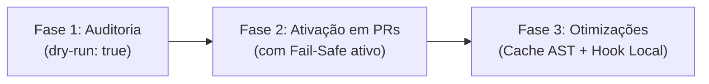

# Guia de Implantação: test-graph-selector

> **Seleção Determinística de Testes por Grafo de Dependências (AST)**  
> *Rode apenas os testes afetados pelo diff do Git, reduzindo tempo e custos de CI com segurança garantida por fail-safe.*

---

## 📋 Sumário
1. [Visão Geral e Arquitetura da Solução](#1-visão-geral-e-arquitetura-da-solução)
2. [Pré-requisitos de Sistema e Ambiente](#2-pré-requisitos-de-sistema-e-ambiente)
3. [Estratégia Recomendada de Rollout](#3-estratégia-recomendada-de-rollout)
4. [Métodos de Implantação em CI/CD](#4-métodos-de-implantação-em-cicd)
   - [Opção 1: GitHub Actions (Recomendado)](#opção-1-github-actions-oficial)
   - [Opção 2: GitLab CI](#opção-2-gitlab-ci)
   - [Opção 3: Outros CIs (Jenkins, Bitbucket, Azure DevOps)](#opção-3-outros-cis-jenkins-bitbucket-azure-devops)
5. [Implantação no Ambiente do Desenvolvedor (Local / Hook Pre-Push)](#5-implantação-no-ambiente-do-desenvolvedor)
6. [Instalação como Pacote CLI Global](#6-instalação-como-pacote-cli-global)
7. [Suporte e Configuração por Linguagem / Framework](#7-suporte-e-configuração-por-linguagem--framework)
8. [Configurações Avançadas e Otimizações de Cache](#8-configurações-avançadas-e-otimizações-de-cache)
9. [Troubleshooting e Resolução de Problemas](#9-troubleshooting-e-resolução-de-problemas)

---

## 1. Visão Geral e Arquitetura da Solução

O **`test-graph-selector`** analisa o código-fonte via AST (Abstract Syntax Tree) através da ferramenta `graphifyy` (v0.9.90), construindo um grafo direcionado de dependências (`imports`, `calls`, `inherits`, `implements`).

Ao receber um diff entre dois commits (`git diff base...head`):
1. **Identifica os nós alterados** no grafo.
2. **Executa uma busca em largura reversa (BFS reversa)** para rastrear todos os arquivos e nós de teste que dependem (direta ou transitivamente) das partes modificadas.
3. **Aplica regras de segurança rígidas (*fail-safe*)**: arquivos de configuração de build, dependências de pacotes (`package.json`, `pom.xml`, `build.gradle`), workflows de CI ou códigos sem modelo de dependência claro disparam automaticamente a **suíte completa**.
4. **Executa apenas os testes estritamente necessários**, gerando relatórios auditáveis em texto, JSON e Markdown.

### Pilares de Confiabilidade:
* **Determinismo:** Sem IA e sem aleatoriedade. Mesmos commits geram exatamente a mesma seleção e relatório.
* **Fail-Safe:** Na menor incerteza, roda a suíte completa de testes. Um erro da ferramenta ou do grafo nunca faz um teste ser pulado.
* **Explicabilidade:** Cada teste selecionado acompanha a cadeia exata de chamada/import até o código alterado.

---

## 2. Pré-requisitos de Sistema e Ambiente

Antes de implantar, certifique-se de que os nós de execução (CI runners ou estações locais) atendem aos requisitos:

| Componente | Versão Mínima | Finalidade |
|---|---|---|
| **Git** | 2.25+ | Cálculo do diff (`--name-status -z -M`) e inspeção de histórico |
| **Node.js** | 18.x ou 20.x+ | Motor de execução do seletor TypeScript (`selector/dist/cli.js`) |
| **Python** | 3.10+ | Indexador AST (`graphifyy==0.9.90`), preferencialmente isolado em `venv` |
| **Bash** | 4.0+ | Orquestrador de scripts Shell (`select-tests.sh`) |
| **Runner de Testes** | Compatível com a stack | Jest, Vitest, Maven (JUnit 5), Gradle (JUnit 5) ou Pytest |

> [!IMPORTANT]
> **Histórico do Git (Checkout Completo Obrigatório):**  
> A seleção depende do cálculo exato do *merge-base* entre a branch de origem e a de destino. É **obrigatório** desativar clones rasos (shallow clone). No GitHub Actions, configure `fetch-depth: 0`.

---

## 3. Estratégia Recomendada de Rollout

Para adotar o `test-graph-selector` com risco zero para a operação da equipe, siga três etapas:



1. **Fase 1 (Observabilidade / `dry-run`):**  
   Configure o CI com `dry-run: true`. A suíte completa continua rodando normalmente, enquanto o time audita o Job Summary para validar a precisão dos testes selecionados.
2. **Fase 2 (Ativação em Pull Requests):**  
   Desative o `dry-run`. Em PRs, somente os testes selecionados rodam. Configure a branch principal (`main`/`master`) para continuar executando a suíte completa no merge.
3. **Fase 3 (Performance e Hook Local):**  
   Ative o cache do AST (`cache: true`), o skip de commits já validados (`skip-tested-tree: true`) e instale o hook de `pre-push` nas máquinas dos desenvolvedores.

---

## 4. Métodos de Implantação em CI/CD

### Opção 1: GitHub Actions (Oficial)

A forma mais direta e recomendada para repositórios no GitHub é utilizar a Action composta inclusa no repositório.

Crie o arquivo `.github/workflows/selective-tests.yml` no projeto alvo:

```yaml
name: Testes Automatizados

on:
  pull_request:
    types: [opened, synchronize, reopened]
  push:
    branches: [main, master]

concurrency:
  group: ${{ github.workflow }}-${{ github.event.pull_request.number || github.ref }}
  cancel-in-progress: ${{ github.ref != 'refs/heads/main' }}

jobs:
  testes:
    name: Testes Seletivos (AST)
    runs-on: ubuntu-latest

    steps:
      # 1. Checkout com histórico completo (OBRIGATÓRIO)
      - name: Checkout do código
        uses: actions/checkout@v4
        with:
          fetch-depth: 0

      # 2. Configuração do Node.js
      - name: Setup Node.js
        uses: actions/setup-node@v4
        with:
          node-version: "20"
          cache: "npm"

      # 3. Setup do ambiente da linguagem do seu projeto (Exemplo com Node/Jest)
      # Se for Java: use actions/setup-java@v4
      # Se for Python: use actions/setup-python@v5
      - name: Instalar dependências do projeto
        run: npm ci

      # 4. Execução do test-graph-selector
      - name: Executar Seleção de Testes
        id: selector
        uses: Pedronovaesdev/test-graph@v1
        with:
          # Inicie com dry-run: true durante os primeiros dias de validação
          dry-run: false
          # Monorepos: especifique a subpasta se necessário (padrão: ".")
          project: "."
          # Linguagem: typescript, angular, vitest, java, java-gradle ou python
          # Se omitido, autodetecta pelos arquivos do projeto
          lang: ""
          # Cache da árvore de AST entre builds
          cache: true
          # Pula testes se a árvore git idêntica já passou no mesmo runner
          skip-tested-tree: false

      # 5. (Opcional) Log das métricas
      - name: Resumo da Execução
        run: |
          echo "Modo de execução: ${{ steps.selector.outputs.mode }}"
          echo "Testes selecionados: ${{ steps.selector.outputs.selected }} de ${{ steps.selector.outputs.total }}"
          echo "Relatório disponível em: ${{ steps.selector.outputs.report }}"
```

---

### Opção 2: GitLab CI

O projeto oferece um template nativo em `ci/gitlab/test-graph-selector.yml`.

Inclua no `.gitlab-ci.yml` do projeto:

```yaml
include:
  - remote: "https://raw.githubusercontent.com/Pedronovaesdev/test-graph/v1/ci/gitlab/test-graph-selector.yml"

workflow:
  rules:
    - if: $CI_PIPELINE_SOURCE == "merge_request_event"
    - if: $CI_COMMIT_BRANCH && $CI_OPEN_MERGE_REQUESTS
      when: never
    - if: $CI_COMMIT_BRANCH == $CI_DEFAULT_BRANCH

testes:
  extends: .test-graph-selector
  image: node:20
  before_script:
    # Instale dependências de sistema para o indexador AST e para seu projeto
    - apt-get update -qq && apt-get install -y -qq python3-venv git
    # Instale as dependências da aplicação
    - npm ci
  variables:
    GIT_DEPTH: "0"                  # Obrigatório: histórico completo
    TGS_PROJECT: "."                # Subpasta do projeto (para monorepo)
    TGS_LANG: ""                    # Deixe vazio para autodeteção
    TGS_DRY_RUN: "false"            # "true" para apenas observar
    TGS_SKIP_TESTED_TREE: "false"   # "true" para reaproveitar árvore aprovada
  rules:
    - if: $CI_COMMIT_BRANCH == $CI_DEFAULT_BRANCH
      interruptible: false          # Na branch principal, roda até o fim
    - when: on_success
```

---

### Opção 3: Outros CIs (Jenkins, Bitbucket Pipelines, Azure DevOps)

Para ambientes genéricos, a execução requer apenas Node 18+, Python com `graphifyy` e o script `select-tests.sh`:

```bash
#!/usr/bin/env bash
set -e

# 1. Garantir histórico completo
git fetch --unshallow || git fetch --all

# 2. Ambiente virtual isolado para o indexador AST
python3 -m venv /tmp/tgs-venv
/tmp/tgs-venv/bin/pip install --quiet graphifyy==0.9.90

# 3. Clonar o test-graph (ou clonar junto ao repositório)
git clone --depth 1 --branch v1 https://github.com/Pedronovaesdev/test-graph.git /tmp/test-graph

# 4. Determinar base de comparação
# Em PR/MR: usar a branch alvo (ex.: origin/main)
# Em push: usar o commit anterior (ex.: HEAD~1)
BASE_REF="${CHANGE_TARGET:-origin/main}"

# 5. Executar o seletor
GRAPHIFY=/tmp/tgs-venv/bin/graphify \
TGS_NO_BUILD=1 \
/tmp/test-graph/select-tests.sh \
  --project . \
  --base "$BASE_REF" \
  --head HEAD \
  --format text
```

---

## 5. Implantação no Ambiente do Desenvolvedor

A ferramenta permite feedback em segundos antes de enviar código ao repositório remoto, bloqueando pushes que quebrariam testes afetados.

### Instalação do Git Pre-Push Hook

Dentro do repositório da sua aplicação:

```bash
# Caso o test-graph esteja clonado localmente:
bash /caminho/para/test-graph/selector/bin/install-hook.sh

# Para monorepo ou configuração específica:
bash /caminho/para/test-graph/selector/bin/install-hook.sh \
  --project apps/web \
  --lang angular \
  --graphify ~/.venv/bin/graphify

# Para desinstalar o hook:
bash /caminho/para/test-graph/selector/bin/install-hook.sh --uninstall
```

### Comportamento do Hook Local:
* **Alterações de documentação:** O push é liberado imediatamente (0 testes).
* **Alterações de código:** Executa localmente apenas os testes afetados. Se falhar, o push é **bloqueado**.
* **Suíte completa disparada (mudança estrutural):** Por padrão, avisa o desenvolvedor e libera o push para o CI executar a suíte pesada.
* **Bypass de emergência:** Caso necessário, use `git push --no-verify` ou configure `TGS_SKIP=1 git push`.

---

## 6. Instalação como Pacote CLI Global

Se preferir disponibilizar o comando `select-tests` globalmente no servidor ou container:

```bash
# 1. Instale o indexador AST via Python
pip install graphifyy==0.9.90

# 2. Empacote e instale o pacote NPM a partir do diretório selector/
cd selector/
npm pack
npm install -g ./test-graph-selector-1.3.0.tgz

# 3. Teste o comando global
select-tests --help
```

---

## 7. Suporte e Configuração por Linguagem / Framework

O `test-graph-selector` identifica automaticamente as seguintes stacks através de arquivos na raiz do projeto:

| Identificador (`--lang`) | Identificação Automática | Runner de Testes Utilizado |
|---|---|---|
| `typescript` | `package.json` | `npx jest --runTestsByPath {files}` |
| `vitest` | `package.json` + `vitest.config.*` | `npx vitest run {files}` |
| `angular` | `--lang angular` explícito | `npx jest --runTestsByPath {files}` |
| `java` | `pom.xml` | `mvn test -Dtest={classes}` |
| `java-gradle` | `build.gradle` ou `build.gradle.kts` | `./gradlew test --tests {classes}` |
| `python` | `pyproject.toml`, `setup.py` ou `pytest.ini` | `pytest {files}` |

### Customização de Regras (.github/test-selector.yml)

Você pode criar um arquivo de configuração customizado na raiz do projeto alvo herdando de qualquer preset:

```yaml
# .github/test-selector.yml
extends: typescript

# Adicionar arquivos de teste customizados
test_patterns:
  - "**/*.spec.ts"
  - "**/*.e2e-spec.ts"

# Arquivos que disparam suíte completa se alterados
full_suite_patterns:
  - "webpack.config.js"
  - ".env.example"

# Customização do comando de execução
command: "npx jest --ci --runInBand --runTestsByPath {files}"
```

---

## 8. Configurações Avançadas e Otimizações de Cache

### 1. Cache de AST (`graphify-out`)
A indexação do AST com `graphify` gera metadados em `<projeto>/graphify-out/`.  
* **Benefício:** A indexação incremental relê **apenas os arquivos modificados**.
* **No GitHub Actions:** Habilitado por padrão (`cache: true`), persistindo o diretório entre runs.

### 2. Skip de Árvore Já Testada (`skip-tested-tree: true`)
Se você faz rebase, amend de mensagem de commit ou reexecuta uma pipeline sem alterar o conteúdo dos arquivos (`git rev-parse HEAD^{tree}`), a ferramenta consulta o cache:
* Se a árvore idêntica já passou nos testes com sucesso, a execução é ignorada (`mode=skipped`), concluindo a etapa em menos de 5 segundos.

---

## 9. Troubleshooting e Resolução de Problemas

### ❌ Erro: "Commit base '...' fora do clone (checkout raso?)"
* **Causa:** O clone do repositório foi realizado com profundidade limitada (`--depth 1`).
* **Solução:** No GitHub Actions, utilize `fetch-depth: 0` no passo `actions/checkout@v4`. No GitLab, defina `GIT_DEPTH: "0"`.

### ❌ Erro: "Sem commit de comparacao (push de branch nova?)"
* **Causa:** O push foi realizado em uma branch recém-criada sem histórico anterior no remoto.
* **Comportamento Esperado:** O seletor entra em modo **fail-safe** e executa a suíte completa para garantir a integridade.

### ❌ Suíte completa rodando com mais frequência do que o esperado
* **Causa:** Alterações em arquivos estruturais dispararam regras de segurança (`package.json`, `pom.xml`, `.github/workflows/`, `application.properties`).
* **Verificação:** Inspecione o arquivo `.selector-out/report.txt` ou o Markdown do GitHub Summary. O relatório aponta exatamente a regra acionada (ex.: `rule: global-config` ou `rule: full-suite-pattern`).

### ❌ Erro de permissão em scripts shell no CI ("Permission denied")
* **Causa:** Scripts commitados a partir de estações Windows perdem a flag de execução (`+x`).
* **Solução:** Adicione um passo `run: chmod +x select-tests.sh` ou configure no Git: `git update-index --chmod=+x select-tests.sh`.

---

## 📦 Estrutura dos Relatórios Gerados

Ao término de cada execução, os relatórios são gravados na pasta `<projeto>/.selector-out/`:

```text
.selector-out/
├── report.txt          # Resumo em texto simples para exibição em terminal/log
├── report.json         # Objeto estruturado com métricas, nós alterados e cadeias
├── report.md           # Tabela detalhada em Markdown (injetada no GitHub Summary)
├── selected-tests.txt  # Lista crua dos testes selecionados
├── command.txt         # Linha de comando exata executada pelo runner
└── mode.txt            # Modo final: selective, full, none, fail-safe ou skipped
```
